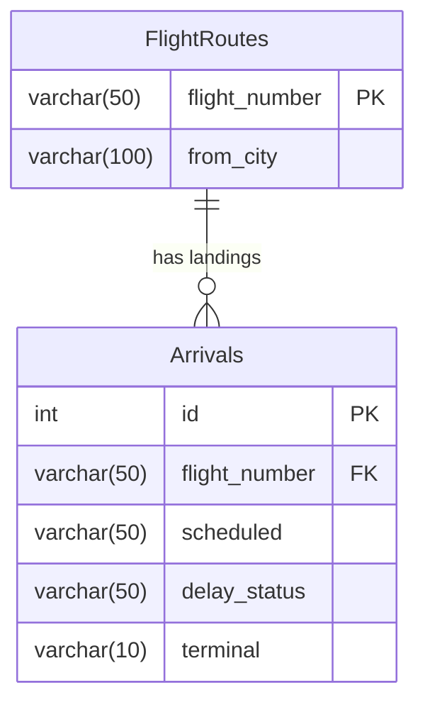

# Flight Arrivals Management System (`JDBC_FlightManager`)

**Course:** Software Engineering Methods (Academic Year 2026–2027)  
**Institution:** Braude College of Engineering | Department of Software Engineering  
**Database Engine:** MySQL 8.0+ | **Language:** Java (JDBC)

---

## 1. Project Description

This project develops a Java JDBC Data Access Layer (DAL) for an airport arrivals management system using the `FlightDB` MySQL database. The laboratory workflow starts with importing raw arrival data from `arrived_flights.csv`, analyzing functional dependencies, and normalizing the original `rawflights` relation into `FlightRoutes` and `Arrivals`. Java programs then query flight information, update a single flight's delay status, and batch-update multiple arrivals. The security exercise demonstrates SQL Injection against a vulnerable string-concatenated SQL statement and its remediation using parameterized `PreparedStatement` queries.

The submitted ZIP contains the Java source files `SimpleFlightUpdater.java`, `AdvancedFlightDispatcher.java`, and `FlightViewer.java`, along with the MySQL JDBC connector JAR. The ZIP does **not** include the CSV import file, SQL schema or dump, or `FlightManagerBase.java`; database creation and successful end-to-end execution therefore cannot be independently verified from this archive alone.

---

## 2. Engineering Team Details (Single-Workstation Driver–Navigator)

| Role | Full Name | Student ID | Braude Academic Email |
| :--- | :--- | :--- | :--- |
| **Student A** | `Nofar Bulgaru` | `[324848969]` | `[nofar.bulgaru@e.braude.ac.il]` |
| **Student B** | `Ofir Haviv' | `[326397668]` | `[ofir.haviv@e.braude.ac.il]` |


- **GitHub Repository URL:** `[Insert actual repository URL]`

---

## 3. Technology Stack

- **Java/JDK:** Java 25 LTS is specified by the course template; confirm the JDK installed for this project.
- **Database:** MySQL Server 8.0+; local database `FlightDB` at `localhost:3306`.
- **JDBC Driver:** MySQL Connector/J 9.5.0 (`lib/mysql-connector-j-9.5.0.jar`), present in the ZIP.
- **IDE:** IntelliJ IDEA (project configuration files included).
- **AI Assistant:** Continue, as required by the exercise; the specific model configuration is not established by the ZIP.
- **Version Control:** Git repository metadata is present; add the actual GitHub URL above.

### Java source files

| File | Purpose |
| :--- | :--- |
| `src/SimpleFlightUpdater.java` | Prompts for a MySQL password and a new status for flight `LX354`, then executes a parameterized `UPDATE` statement. |
| `src/AdvancedFlightDispatcher.java` | Uses `PreparedStatement`, `addBatch()`, and `executeBatch()` to update arrival IDs `1`, `3`, and `5` to `Landed - Final`. |
| `src/FlightViewer.java` | Prompts for a password and terminal (`2`, `3`, `4`, or `5`), performs an `INNER JOIN`, filters using a bound terminal parameter, and displays the results. It also prints column metadata for troubleshooting. |

### Running the project

1. Start MySQL and ensure the `FlightDB` database and normalized tables exist.
2. Open the project in IntelliJ IDEA and configure a compatible JDK.
3. Ensure the MySQL Connector/J JAR in `lib/` is on the project classpath.
4. Run the desired Java class's `main` method and enter the MySQL root password when prompted.
5. For `FlightViewer`, enter one of the supported terminal values: `2`, `3`, `4`, or `5`.

---

## 4. Database Normalization (3NF) & Functional Dependencies ($F$)

### 4.1 Functional Dependencies ($F$) in `rawflights`

The original relation described in the exercise is:

`rawflights(scheduled, flight, fromC, delay, terminal)`

The specified functional dependency is:

`flight -> fromC`

This means the flight identifier determines the origin city. The precise candidate keys and any additional dependencies must be checked against the actual schema and data; the ZIP does not contain the SQL DDL.

### 4.2 Why `rawflights` Violated 3NF

When a flight's origin city is repeated across multiple arrival records and `flight` is not a superkey of the raw arrival relation, the dependency `flight -> fromC` creates redundancy inconsistent with 3NF (assuming `fromC` is non-prime). Decomposition addresses:

- **Update anomaly:** A changed origin city would otherwise require updating multiple arrival rows.
- **Insertion anomaly:** A flight route could not easily be recorded independently of an arrival.
- **Deletion anomaly:** Removing the last arrival for a flight could accidentally remove its route information.

Separating route data from arrival events reduces duplication and supports referential integrity.

### 4.3 Decomposed 3NF Relational Schema

The student README template specifies the following intended design:

- **`FlightRoutes`:** `flight_number` (primary key), `from_city`.
- **`Arrivals`:** `id` (primary key), `flight_number` (foreign key referencing `FlightRoutes.flight_number`), `scheduled`, `delay_status`, `terminal`.

**Schema verification:** These names and types are taken from the supplied course template, not from a database dump in the ZIP. Confirm them with `SHOW CREATE TABLE FlightRoutes;` and `SHOW CREATE TABLE Arrivals;` before final submission.

---

## 5. Independent AI Prompt (Part 4 – `FlightViewer.java`)

**Important:** The course requires the *exact* English prompt submitted to Continue. The text below is the prompt drafted in the conversation; replace it if the text actually sent to Continue differed.

```text
Create a new Java file named `FlightViewer.java` in my existing JDBC_FlightManager project.

Follow these requirements:

1. Connect to the existing MySQL database named `FlightDB` on localhost using JDBC.
2. Use `Scanner` to prompt the user to enter the MySQL root password at runtime. Do not hardcode the password.
3. Use try-with-resources to manage the Scanner, Connection, PreparedStatement, and ResultSet.
4. Ask the user to enter a target terminal number. The valid terminal numbers in the dataset are 2, 3, 4, and 5.
5. Create a SQL SELECT query using an INNER JOIN between the `Arrivals` and `FlightRoutes` tables.
6. Filter the results using `WHERE Arrivals.terminal = ?` and sort them using `ORDER BY Arrivals.scheduled ASC`.
7. Use a secure `PreparedStatement` with a `?` placeholder instead of concatenating user input into the SQL query.
8. Since the `terminal` column is VARCHAR(10), read the terminal number as a String and bind it using exactly `pstmt.setString(1, terminal)`.
9. Execute the query and print the results in a clear, formatted, readable table in the console, including relevant flight and route information.
10. If no flights are found for the selected terminal, display an appropriate message.
11. Handle SQL exceptions properly.

Important instructions:
- Use the existing database schema and the actual column names from the project.
- Do not modify the existing database, tables, or data.
- Do not modify any existing Java files.
- Do not add external libraries or dependencies.
- Keep the code simple, readable, and appropriate for a Software Engineering student.
- Generate the complete working `FlightViewer.java` file with a `public static void main(String[] args)` method.
```

---

## 6. Entity Relationship Diagram (ERD)

The diagram below follows the **provided student README template**; its field definitions require confirmation against the actual database.



---

## 7. Security Audit Summary (Part 5 – SQL Injection Mitigation)

- **Attack payload:** `Landed' #`
- **Original vulnerability:** The original insecure `SimpleFlightUpdater` built an SQL string by concatenating user input into the `delay_status` value. The apostrophe in the payload closes the string literal, and MySQL's `#` begins a comment, removing the remaining `WHERE flight_number = 'LX354'` clause from the executed SQL. The resulting statement updates every row rather than only the selected flight.
- **Reported impact:** The exercise describes 299 affected arrival records. This count cannot be independently confirmed from the supplied ZIP because it contains neither the database data nor an attack screenshot.
- **Remediation:** The `SimpleFlightUpdater.java` present in the ZIP uses `PreparedStatement` with `UPDATE Arrivals SET delay_status = ? WHERE flight_number = ?` and binds both values with `setString()`. This treats the payload as data rather than SQL syntax, preventing this injection from altering the query structure.
- **Additional protection:** `FlightViewer.java` also binds its terminal filter using `pstmt.setString(1, terminal)`.

**Submission evidence:** Include the required console screenshots and database evidence in the official submission document. The supplied ZIP alone does not verify the attack or successful recovery.

---

## 8. License

Distributed under the **Braude College Academic License** (Software Engineering Methods, 2026–2027), as specified in the supplied course materials.
